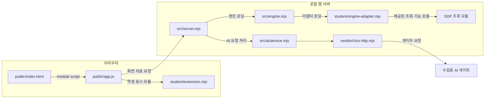

# 프로젝트 안내서: 구성·실행·지원 범위

이 문서는 현재 `on-client` 프로젝트의 목적, 실제 파일 구성, 실행 계약 및 확인 범위를 설명합니다. 코드와 설정을 읽어 대조한 문서이며, 여기에 적힌 명령이나 Mermaid 흐름을 실행해 검증했다는 뜻은 아닙니다. 학생이 작성하는 부분과 제공 코드의 경계는 각 단계의 공식 과제 안내를 우선합니다.

## 목적과 사용 범위

이 프로젝트는 학생이 본인 계정의 보호 현황, 업무 앱 접근 판정, 본인에게 귀속된 접속 기록과 저장된 XDR 경보를 확인하도록 만드는 보안 Agent의 Node.js 시작 틀입니다. `student/extension.mjs`에는 학생이 채울 화면 표시 함수가 있고, `student/engine-adapter.mjs`에는 제공 엔진과 학생 코드 사이의 경계가 있습니다.

기록 조회는 모든 직원의 전체 로그나 실시간 전체 위협 탐지가 아닙니다. SDP 조회 안내의 계약은 본인 접속 기록 최근 40건, 본인 등록 기기 최대 100개, 현재 검증된 세션 한 개입니다. XDR 경보는 이미 저장된 자료이며 화면을 열 때 새로 탐지하는 기능이 아닙니다. 연결할 수 없는 예전 기록의 앱 ID나 세션·기기 상태는 확인 불가일 수 있습니다. 실제 운영 계정에서의 이용 가능성은 별도로 확인해야 합니다.

AI 연결 점검은 모델 목록 접근 확인이지 사건 설명 실행이 아닙니다. 사건 설명은 선택한 보안 기록의 근거를 바탕으로 하는 참고 정보이며, 그 자체로 보안 조치를 실행하지 않습니다. 조치 제안, 사람 확인, 서버 접수, 처리 결과 조회와 실제 효과 확인은 서로 다른 단계입니다. ACK(요청 접수)는 효과 확인이 아니며, 학생 표시 함수에 조치 전송 권한을 추가하지 않습니다.

취약점 화면은 담당자가 공개 조회를 승인한 패키지만 대상으로 정확한 설치 버전을 OSV의 알려진 취약점 자료와 대조하도록 설계되어 있습니다. 승인 목록이 비어 있으면 공개 조회를 하지 않을 수 있습니다. `none_found`는 조회 범위와 시점에서 알려진 항목이 없다는 뜻이지, 패키지나 앱이 안전하다는 보장이 아닙니다. 조회 실패·미조회·일부 조회·확인 불가는 취약점 없음과 구분합니다.

## 실행 및 패키지 계약

프로젝트 기준은 `package.json`에 기록되어 있습니다.

- Node.js `24.19.0` (`engines.node`)
- 외부 npm 의존성 선언 없음
- `npm start` → `node src/server.mjs`
- `npm run demo` → `node src/server.mjs --demo` (예제 자료)
- `npm run check` → `node --check student/extension.mjs` (학생 파일 문법 검사만)

`tools/start-alekov.ps1`은 기본 포트 `5189`에서 로컬 서버를 실행하고 `http://127.0.0.1:5189/`를 안내합니다. 이 도구는 Node.js 22~24를 허용하고 `24.19.0`을 권장하므로, 실행 스크립트의 허용 범위와 `package.json`의 기준 버전은 동일한 문장이 아닙니다. 스크립트는 포트가 사용 중이면 다른 프로세스를 종료하지 않고 중단하며, 서버가 HTTP 응답을 하는지 확인합니다. HTTP 응답만으로 로그인, 업무 시스템, AI 또는 SDP 연결의 성공을 뜻하지 않습니다.

현재 파일 목록에서 `package-lock.json`은 찾지 못했습니다. 따라서 이 문서에서는 잠금 파일이나 설치 패키지의 실제 버전을 확인했다고 주장하지 않습니다. 학생의 실제 환경에서 실행, 설치 또는 브라우저 동작도 이 문서를 작성하면서 실행하지 않았습니다.

## 주요 구성 요소와 데이터 흐름

| 위치 | 역할 |
| --- | --- |
| `public/index.html`, `public/app.js`, `public/style.css` | 제공 브라우저 화면, 화면 동작 및 스타일 |
| `public/ai-connect.mjs`, `public/vulnerabilities-view.mjs` | 제공 화면의 AI 연결·취약점 조회 화면 모듈 |
| `student/extension.mjs` | 학생이 구현하는 화면 표시 확장 함수 |
| `student/engine-adapter.mjs` | 서버가 로딩하며 제공된 SDP 호스트의 조회·판정 기능을 전달하는 어댑터 |
| `src/server.mjs` | 로컬 Node.js 앱 서버 진입점 |
| `src/engine.mjs`, `src/engine/` | 엔진 경계 및 SDP 호스트 연결·조회 모듈 |
| `src/connection/` | 연결 승인과 서버 측 연결 상태 관리 |
| `src/ai/` | 앱 AI 연결·권한·자격 보관 및 요청 서비스 |
| `vendor/clco-http.mjs` | 수업용 AI 게이트와 통신하는 서버 측 HTTP 모듈 |
| `src/vulnerabilities/` | lockfile 및 설치 메타데이터 대조와 OSV 조회 |
| `src/actions/` | 조치 상태·저장·서비스 경계. 코드 존재만으로 실제 외부 집행 연결을 뜻하지 않음 |
| `tools/` | Windows 실행 및 담당자가 제공한 호스트 설정을 전달하는 도구 |
| `docs/` | 학생 안내, 연결·오류 안내, 구현 계약 및 단계 과제 |

`public/index.html`이 브라우저의 `public/app.js`를 불러오며 학생 표시 확장은 브라우저 화면에서 사용됩니다. 학생 표시 함수는 로컬 서버의 렌더러가 아닙니다. 브라우저는 별도로 로컬 서버에 자료를 요청하고, 서버 측 엔진 어댑터/엔진이 접근 판정과 기록 조회에 관여합니다. AI 요청은 로컬 서버의 AI 서비스에서 게이트 전송 모듈로 이어지는 별도 흐름입니다. 도식은 모듈의 책임 경계를 나타내며, 실제 접속·권한·응답 성공을 주장하지 않습니다. 서버 설정이 유효하지 않거나 연결을 확인하지 못하면 실제 외부 시스템 연결은 미확인으로 남습니다.

학생 화면에서의 상세 함수 목록과 단계별 확인 방법은 [21단계 학생용 코드·실행 보충 안내](STUDENT_STAGE21_REFERENCE.md)를 참고하세요. 이 보충 문서는 `student/extension.mjs`의 함수 본문 전체를 실행·검증했다는 뜻은 아닙니다.

## 제공 기능과 학생 작성 부분

제공 코드는 화면 골격, 로컬 서버, 요청 라우팅, 엔진·AI·SDP·OSV·조치 서비스의 경계와 보호 검증을 제공합니다. 학생 작업의 주 대상은 `student/extension.mjs`의 과제별 표시 함수 및 `student/engine-adapter.mjs`입니다. 실제 과제에서 지정하지 않은 경우 `src/`, `public/`, 인증·판정 설정이나 제공 엔진 구현을 수정하지 마세요.

서버가 제공하는 상태·자료를 학생 함수에 전달해 그리는 계약과, 서버가 실제 원천에 연결되어 있는지는 별개의 사항입니다. 데모 자료, 합성 시험 자료, 코드상 가능한 경로는 실제 계정의 운영 권한이나 실제 시스템 처리의 증거가 아닙니다.

## 장애 확인과 복구 범위

| 상황 | 확인할 것 | 안전한 다음 단계 |
| --- | --- | --- |
| 로컬 서버가 열리지 않음 | PowerShell 실행 도구의 Node.js 버전, 작업 폴더, 포트 사용 상태와 서버 창의 오류 | `docs/STUDENT_LAUNCH_GUIDE.md`와 `docs/CONNECTION_TROUBLESHOOT.md`의 절차를 따릅니다. 다른 프로그램을 임의 종료하거나 설정 파일을 임의 생성하지 않습니다. |
| AI 연결이 준비 중·확인 불가 | 화면의 안전한 상태 코드와 담당자 안내 | 앱 권한·계정 연결 준비를 담당자에게 확인합니다. Workbench 열쇠나 공급사 원본 열쇠를 복사하지 않습니다. |
| 모델 점검은 성공했지만 사건 설명은 없음 | 연결 점검과 별도 사건 설명 요청을 구분 | 설명 기능을 성공했다고 기록하지 않습니다. 실제 설명 권한이 없으면 운영 담당자에게 확인합니다. |
| SDP·기록 조회 실패 또는 확인 불가 | 조회 실패와 빈 목록, 확인 범위 및 제공 화면의 오류 코드 | 제공 화면의 수동 다시 불러오기와 담당자 안내를 사용합니다. 실패를 빈 기록이나 정상 상태로 바꾸지 않습니다. |
| 취약점 조회 실패·일부 조회·미조회 | 전체 조회 상태, 패키지별 상태, 출처와 확인 시각 | `partial`, `not_checked`, `not_configured`, `unverifiable`를 취약점 없음과 구분합니다. 허용 목록·의존성을 임의 변경하지 않습니다. |
| 조치 상태가 pending 또는 unknown | 접수 여부와 효과 관측 여부 | ACK를 성공으로 보지 않습니다. 제공 화면이 지원하는 결과 재조회만 사용하고, 미확인 결과를 효과 없음으로 단정하지 않습니다. 실제 집행이 준비되지 않았으면 시험 삼아 요청하지 않습니다. |

실패 후 재시도는 과제 화면이 안내하는 수동 동작만 사용합니다. 자동 재시도, 서버 정책 변경, 다른 사용자의 자격 사용, 비밀정보를 채팅에 붙여 넣는 방식은 복구 절차가 아닙니다.

## 확인된 문서 정정 및 미확인 사항

- `docs/AI_SETUP_GUIDE.md`의 준비 절에는 시작 틀의 스크립트를 `start`·`demo`·`test`라고 쓰고 있습니다. 현재 `package.json`에는 `test`가 없고 `check`가 있으므로 그 문장은 오래된 안내입니다. 학생 확장 문법 검사는 `npm run check` 또는 `node --check student/extension.mjs`입니다. 문서 명령을 실제 실행했다는 뜻은 아닙니다.
- 버전 안내에서는 `package.json` 기준 `24.19.0`과 PowerShell 실행 도구가 허용하는 `22~24`를 구분합니다.
- 현재 파일 경로 검색에서 `package-lock.json`을 찾지 못했으므로 lockfile 해시·설치된 패키지의 실제 버전은 확인하지 않았습니다.
- 이 문서 작성 과정에서 Node.js 문법 검사, `npm` 스크립트, 설치, 서버 실행, 브라우저 조작, 실제 SDP·AI·OSV 조회 및 조치 집행은 하지 않았습니다. 실제 계정의 권한·운영 연동·외부 시스템의 효과는 미확인입니다.

비밀값은 `.env`처럼 제출에서 제외하도록 정해진 로컬 파일에만 담당자 지침에 따라 보관하고, 문서·코드·Git 커밋·스크린샷·도움정보에 적지 않습니다. 이 안내서는 새 자격 설정이나 제출 조건을 추가하지 않습니다.
