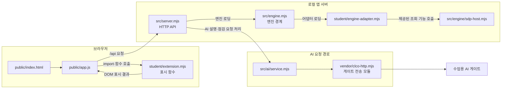

# 학생 안내: 실행·구성·코드 범위·21단계 제출

이 문서는 학생 프로젝트 `on-client`의 현재 파일을 읽고 정리한 안내입니다. 문서에 적힌 명령을 여기서 실행하거나 앱을 브라우저에서 확인한 것은 아닙니다. 실제 환경·계정·서비스 연결은 별도 확인 사항입니다.

## 실행 절차

실제 앱 폴더:

```text
C:\Users\User\AppData\Local\ALEPH\Workbench\projects\우사기강-방어전\on-client
```

필요한 프로그램은 Node.js와 함께 설치되는 npm입니다. `package.json`의 엔진 기준은 Node.js `24.19.0`이며, 실행 도구의 지원 범위와 권장 버전은 도구 안내를 따릅니다. 자신의 설치 버전을 확인하려면 PowerShell에서 다음을 실행합니다.

```powershell
node --version
npm --version
```

1. 파일 탐색기에서 위 `on-client` 폴더를 엽니다.
2. 폴더의 빈 곳에서 Shift+마우스 오른쪽 버튼을 눌러 PowerShell을 열거나, PowerShell에서 다음을 실행합니다.

   ```powershell
   Set-Location -LiteralPath 'C:\Users\User\AppData\Local\ALEPH\Workbench\projects\우사기강-방어전\on-client'
   ```

3. `node --version`과 `npm --version`으로 설치 버전을 확인합니다. `package.json`은 `24.19.0`을 지정합니다. 이 문서를 작성하는 동안 학생 PC의 실제 설치 버전은 아래 검증 이력과 구분해 확인합니다.
4. 실제 연결이 아닌 기본 앱을 시작하려면 다음을 실행합니다.

   ```powershell
   npm start
   ```

   이는 `package.json`에 정의된 `node src/server.mjs`를 실행합니다. 기본 포트를 사용한 일반 모드의 코드상 정상 시작 메시지는 `케셰브 연결 확인: http://127.0.0.1:5189`입니다(`src/server.mjs`의 listen 콜백). 이름에 “연결 확인”이 있어도 계정·AI·SDP 연결 성공을 뜻하지 않습니다. 이 메시지는 코드를 읽어 확인했으며 이번 문서 수정에서 서버를 실행해 관측한 것은 아닙니다.
5. 브라우저에서 다음 주소를 엽니다.

   ```text
   http://127.0.0.1:5189
   ```

6. 종료하려면 서버를 실행 중인 PowerShell 창에서 `Ctrl+C`를 누릅니다. 다시 실행할 때는 같은 `on-client` 폴더에서 `npm start`를 실행하고 위 주소를 다시 엽니다.

`npm run demo`는 예제 자료를 표시하는 실행이고 실제 연결 성취가 아닙니다. 현재 `package.json`의 확인 명령은 `npm run check`이며, 이는 학생 확장 파일의 Node 문법 검사입니다. 설치를 위해 `npm install`을 실행할 필요가 있는지 이 문서만으로 판단하지 않습니다.

## 실제 코드의 구성과 요청 흐름

`public/index.html`과 `public/app.js`는 브라우저 화면을 제공합니다. 브라우저의 `public/app.js`는 학생 표시 모듈 `student/extension.mjs`를 불러와 전달된 자료를 화면에 그립니다. 이 모듈은 표시를 담당하며 서버 요청·정책 결정·인증을 대신하지 않습니다.

서버 요청은 별도 흐름입니다. 브라우저가 로컬 서버의 API를 요청하고, 서버의 엔진 경계와 학생 엔진 어댑터를 통해 접속 판정·사용자 기록 같은 엔진 자료를 조회합니다. 이 흐름은 학생 표시 모듈을 거쳐 서버로 가는 구조가 아닙니다.



AI 설명의 브라우저 요청은 `/api/ai/explain` 경로로 서버에 전달됩니다. 서버의 AI 기능은 `src/ai/service.mjs`의 설명 서비스를 사용하고, 게이트 전송은 `vendor/clco-http.mjs`의 HTTP 전송 코드를 사용합니다. 코드에 요청 경로와 전송 구현이 있다는 사실은 실제 계정 권한, 모델 호출 성공, 운영 연결 성공을 뜻하지 않습니다. 이 문서 작성 중 실제 AI 요청은 하지 않았습니다.

## 학생 확장 함수별 확인 범위

아래 표는 `student/extension.mjs`에 있는 학생 화면 함수의 역할과 제공 코드와의 경계를 요약합니다. 학생 함수는 제공 화면이 전달한 값을 표시합니다. 서버 API 호출, 로그인, 정책 변경 또는 실제 집행은 제공 화면·서버 경계의 역할입니다.

| 함수 | 역할 및 학생이 작성하는 범위 | 제공 코드 경계 | 확인 방법 및 현재 미확인 |
|---|---|---|---|
| `createStudentView` | 학생 화면 함수 묶음을 제공 화면에 반환 | 제공 앱이 함수를 호출하고 결과를 화면에 배치 | 코드 읽기로 호출 경계를 검토. 브라우저 동작 미확인 |
| `renderIdentity` | 전달된 계정·기기·세션 자료 표시 | 자료 조회와 로그인 상태 판정은 서버/제공 화면 | 코드 읽기만 수행. 실제 계정 자료 미확인 |
| `renderDecision` | 선택 앱의 전달된 접근 판정·이유·시각 표시 | 판정 요청과 정책은 제공 서버 | 코드 읽기만 수행. 실제 업무 앱 판정 미확인 |
| `renderEvents` | 접속·XDR 기록, 필터 및 선택 기록 상세 표시 | 기록 조회 범위·데이터는 제공 서버 | 코드 읽기만 수행. 실제 기록·필터 화면 미확인 |
| `renderStatus` | 기기·세션·알림·진단 상태와 도움정보 표시 | 조회·다시 불러오기 동작과 자료는 제공 화면/서버 | 코드 읽기만 수행. 복사·재조회 브라우저 동작 미확인 |
| `renderAiConnection` | AI 연결/점검 결과와 실패 상태 표시 | 연결 승인·점검 요청 및 자격 처리는 제공 화면/서버 | 코드 읽기만 수행. 운영 연결과 모델 점검 미확인 |
| `renderExplanation` | 선택 사건에 대한 참고용 설명과 근거 표시 | 설명 요청·서버 검증·AI 호출은 제공 서버 | 코드 읽기만 수행. 실제 모델 설명 호출·응답 미확인 |
| `renderAction` | 조치 요청의 전달 상태와 관측 결과 표시 | 사용자 확인·서버 요청·결과 조회는 제공 화면/서버 | 코드 읽기만 수행. 실제 조치 연동·효과 미확인 |
| `renderVulnerabilities` | 전달된 패키지/OSV 조회 결과 표시 | 잠금 파일 대조와 외부 조회는 제공 서버 | 코드 읽기만 수행. 현재 OSV 조회와 화면 미확인 |

표의 “학생이 작성하는 범위”는 함수 입력과 출력 표시의 구분입니다. 지원 구현이라고 해서 계정 연결·AI 응답·실제 집행이 검증되었다는 뜻은 아닙니다. 이번 문서 작업에서 코드를 실행하거나 모의 데이터를 실행하지 않았습니다. 이전 대화에서 Codex가 수행한 문법 검사·모의 DOM 점검은 과거 점검 이력이며, 이번 문서 수정에서 다시 실행한 결과가 아닙니다. 실제 브라우저·운영 연결 확인과 구분합니다.

## 지원 범위와 실행·검증 상태

- 기본 `npm start`는 로컬 앱 시작용입니다. 실제 계정·엔진·AI 게이트·업무 앱 연결은 별도 권한 및 환경 준비가 필요합니다.
- `npm run demo`의 결과는 예제 자료입니다.
- 접속 기록은 제공 서버의 본인 조회 범위이며 전체 직원 로그나 실시간 전체 위협 탐지가 아닙니다. 세션 자료는 전달된 범위에 한정됩니다.
- OSV에서 조회 결과가 없다는 사실은 앱 전체의 안전을 보장하지 않습니다.
- 2026-10-26 Codex 검토에서 버전 명령으로 직접 확인한 값: Node.js `v24.19.0`, npm `11.17.0`, Git `2.56.0.windows.2`. 버전 확인은 앱 실행이나 연결 성공의 검증이 아닙니다.
- 이번 문서 변경에서 서버 실행, 브라우저 표시, 네트워크 요청, AI 요청, 보안 조치, 외부 조회는 수행하지 않았습니다.

## 21단계 문서와 제출 안내

21단계 문서는 README, 학생 문서, 글로 쓴 구성도, 실행 파일, 설정 견본의 설명을 실제 커밋 코드와 대조합니다. 서버 판정은 제출된 커밋의 내용을 읽어 코드와 문서가 맞는지 검토하는 절차입니다. 문서에 적힌 명령을 서버가 실행해 확인하는 것은 아닙니다. 문서가 실행 가능하다고 적혀 있다는 이유만으로 실제 실행 검증이 된 것으로 쓰지 않습니다. 비밀값은 제출에서 제외되는 `.env` 같은 파일에만 두고 문서에 기록하지 않습니다.

기존 제공 문서의 **“21·22단계 판정 방식 미확정”**이라는 표현은 현재 공식 안내와 다릅니다. 현재 안내에서는 21·22단계가 과제 화면에서 저장소 주소와 40자리 커밋을 직접 입력하는 흐름이며, AI가 제출된 커밋의 자료를 읽어 판정합니다. 이를 미확정이라고 안내하지 않습니다.

비공개 저장소의 원문은 해당 단계 화면의 **「비공개 저장소 원문 준비 방법」**을 펼쳐 **「원문 전달 도구 받기」**를 이용합니다. ZIP과 JSON은 프로젝트 밖에 두고, 제출할 프로젝트의 Git 최상위 폴더에서 실행합니다. 실제 `student-source-cli.mjs` 명령은 과제 화면의 최신 안내에 적힌 그대로 사용하고, 도구·출력 경로와 40자리 커밋을 본인 환경 및 제출 대상으로 확인해 지정합니다. 이 문서에서 도구 명령을 추측해 작성하지 않습니다. 현재 워크벤치의 「포털 제출 준비」는 13~20단계용이므로 21단계에는 사용하지 않습니다. 생성 JSON을 같은 단계의 **「비공개 저장소 원문 묶음」**에서 선택하고 저장소·커밋·단계를 재확인한 뒤 제출합니다. 원문 전달 완료와 AI 검토 통과는 서로 다른 상태입니다. 원문 전달만 실패하면 기존 접수를 유지하고 「원문만 다시 보내기」를 사용합니다. 이 문서 변경에서는 커밋·업로드·제출을 하지 않았습니다.

관련 안내: [프로젝트 구성 및 모듈 참조](PROJECT_REFERENCE.md), [학생 실행 안내](STUDENT_LAUNCH_GUIDE.md), [처음 시작하기](GETTING_STARTED_STUDENT.md), [README](../README.md).

---

문서 작성 시 직접 읽은 코드 경로는 `public/app.js`, `student/extension.mjs`, `student/engine-adapter.mjs`, `src/server.mjs`, `src/engine.mjs`, `src/ai/service.mjs`, `vendor/clco-http.mjs`, `package.json`입니다. 문서의 정확한 운영 환경 동작은 로컬 Windows에서 실행하고 확인해야 합니다.
